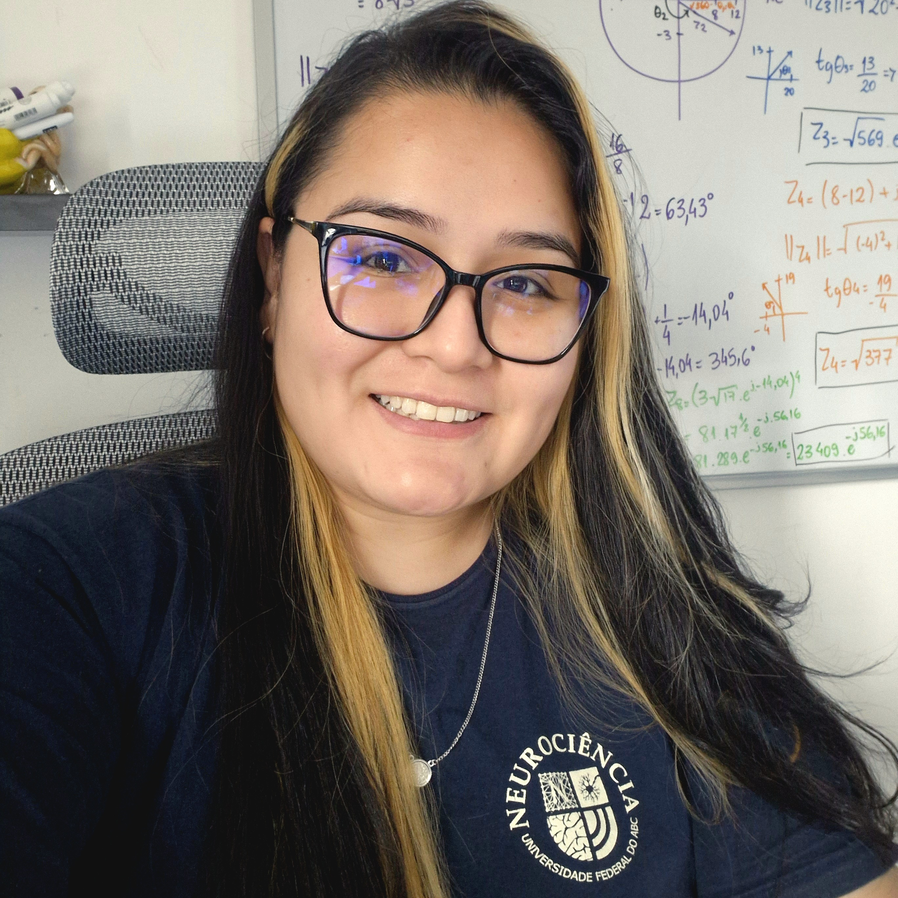

# Olá, eu sou a Erika Brassel Orellana 👋

Seja bem-vinda(o) ao meu portfólio profissional e acadêmico! 

Sou graduanda em **Engenharia Biomédica e Neurociências** na Universidade Federal do ABC (UFABC). Atualmente, estou focada em pesquisa, desenvolvimento de sistemas embarcados e instrumentação voltada para a neurotecnologia como parte do meu trabalho de graduação.

---

## 🚀 Projetos em Destaque

### [Integração de Sistema de Bioimpedância Elétrica (Trabalho de Graduação)](./bioimpedancia-tg)
* **Descrição:** Projeto de integração entre hardware em microcontrolador STM32 e interface gráfica em Processing, unindo e dando continuidade aos trabalhos prévios de instrumentação e software.
* **Estrutura do Repositório:** 
  * 📚 [Conteúdos e Estudo](./bioimpedancia-tg#conteudos-e-estudo) (Bases teóricas, STM32, Processing e referências)
  * 🛠️ [Desenvolvimento e Histórico](./bioimpedancia-tg#desenvolvimento-e-historico) (Evolução prática da integração e diário de bordo)

---

## 🛠️ Tecnologias e Ferramentas
* **Firmware / Embarcados:** STM32, Arduino C/C++
* **Software / Análise:** Processing, Python, LaTeX
* **Áreas de Interesse:** Neurotecnologia, Processamento de Sinais Biológicos, Dispositivos Médicos e Pesquisa Clínica.

📫 *Sinta-se à vontade para explorar os repositórios e acompanhar a evolução dos meus trabalhos!*
